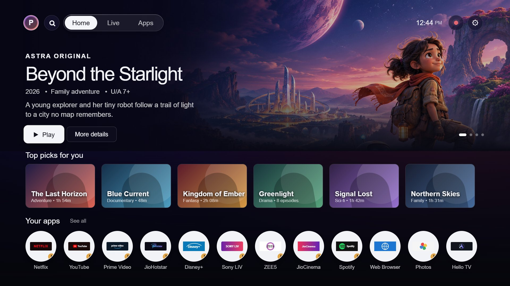

# Astra Home

> An Apple-inspired Liquid Glass launcher for older LG webOS TVs, built for the constraints of 2014-era hardware.




Astra Home is a standalone, remote-first TV interface for an older LG Smart TV.
It combines a cinematic streaming layout with lightweight fake-glass materials,
without frameworks, runtime blur, or a build pipeline.

> **Status:** the Home screen has been inspected in desktop Chrome. Physical-TV
> validation, streaming app IDs, and performance measurements are still pending.

## Highlights

- **Liquid Glass without expensive blur.** Layered gradients, borders, highlights,
  and static sheen produce depth on an engine without `backdrop-filter`.
- **Built for a remote.** One named-zone focus manager handles arrows, OK, Back,
  repeat throttling, focus restoration, modals, and Magic Remote pointer input.
- **Honest integrations.** Unsupported and unverified system features explain their
  limits instead of pretending to work.
- **Small and dependency-free.** The application JavaScript is about 24 KB,
  written in ES5 for the target browser.
- **Performance controls.** Max, Auto, and Lite modes sit alongside Full, Reduced,
  and Off motion preferences.
- **Configurable launches.** App IDs, visibility, and ordering can be adjusted on
  the television; diagnostics can probe restricted app-listing behavior.

## Screenshots

Only the Home capture below completed reliably during desktop QA. Other screens
are implemented, but screenshots will be added after a reliable browser or
physical-TV capture.

| Home |
|---|
|  |

<!-- TODO: add real Apps, Media, Settings, Inputs, and Network screenshots. -->

## Compatibility

| Item | Target / status |
|---|---|
| Primary television | LG 43UF770T-TA |
| webOS generation | webOS 2.0 |
| Firmware | 04.06.25 |
| Graphics stage | 1920×1080, scaled to the current viewport |
| Development SDK | webOS TV SDK 2.2.0 |
| CLI used for packaging | webOS TV CLI 3.2.6 |
| Other televisions / webOS versions | Untested |

The packaged application ID is `com.pranav.lgtv.launcher`.

## Feature status

Legend: ✅ tested on TV · 🧪 tested in desktop browser · 🛠️ implemented, TV test
pending · ⛔ unavailable or unverified on the target platform.

| Feature | Status | Notes |
|---|---|---|
| Home layout and 1280×720 scaling | 🧪 | Real desktop-browser render inspected |
| 1920×1080 stage | 🛠️ | Real render captured; complete interaction suite pending |
| Remote focus zones and restoration | 🛠️ | Syntax/static checks passed; physical remote pending |
| Apps, Media, and Settings screens | 🛠️ | Implemented; full browser and TV walkthrough pending |
| Themes, clock, motion, and performance settings | 🛠️ | Persist through guarded local storage |
| Network status | 🛠️ | Uses Connection Manager with timeout/fallback |
| App launching | 🛠️ | Uses documented Application Manager; IDs need TV verification |
| Installed-app enumeration | ⛔ | Diagnostic probe included; ordinary access is likely restricted |
| Input/source switching | ⛔ | No verified public third-party API for this target |
| HTML5 test media | 🛠️ | Playback and codec result pending on the TV |
| FPS overlay | 🛠️ | Implemented; no TV measurements recorded |

See the complete, deliberately conservative [test report](docs/TEST_REPORT.md).

## Quick start

### Prerequisites

- LG webOS TV SDK or CLI.
- Developer Mode enabled on the television.
- A registered CLI device created with `ares-setup-device`.

### Verify and package

From PowerShell at the repository root:

```powershell
.\scripts\verify.ps1
ares-package launcher/
```

### Install, launch, and debug

```powershell
ares-install --device <your-device-name> com.pranav.lgtv.launcher_0.4.0_all.ipk
ares-launch --device <your-device-name> com.pranav.lgtv.launcher
ares-inspect --device <your-device-name> --app com.pranav.lgtv.launcher --open
```

The same `ares-*` commands work from a compatible macOS or Linux shell. Package
files are ignored by Git and should be distributed through GitHub Releases.

For device registration, session renewal, and common errors, read
[Installation and troubleshooting](docs/INSTALL.md).

## Using Astra Home

### Remote controls

| Input | Behavior |
|---|---|
| Arrow keys | Move within or between named focus zones |
| OK / Enter (13) | Activate the focused control |
| LG Back (461) | Close a modal or return Home |
| Escape (27) / Backspace (8) | Desktop Back fallbacks |
| Back twice from Home | Request application exit through the platform bridge |
| Magic Remote pointer | Focus on hover and activate on click |

Held directional keys are throttled to reduce input flooding on older hardware.

### Configure application IDs

Open **Settings → App collection** to edit each launch ID, hide an app, or move it
earlier in the collection. **About & diagnostics → Probe app listing** tests
whether the television exposes an app list; failure is expected on restricted
retail devices.

These community-known candidates are intentionally **unverified and not
preconfigured**:

| App | Candidate starting point |
|---|---|
| Netflix | `netflix` |
| YouTube | `youtube.leanback.v4` |
| Prime Video | `amazon` |
| JioHotstar / Hotstar | Model and region dependent; no reliable candidate |

A failed launch produces a toast and keeps focus in the launcher.

## How it works

```text
launcher/
├── js/core/       store · events · platform · router · focus · actions · toast
├── js/ui/         clock · header · cards · rails
├── js/screens/    home · apps · media · settings · inputs · network
├── css/           tokens · glass · layout · components · motion
└── assets/brands/ original placeholder artwork
```

- **Focus manager:** owns the single focused element, named zones, directional
  movement, repeat throttling, modal trapping, and restoration.
- **Action registry:** every visible control delegates through a registered
  `data-action`; missing or unavailable actions report an error.
- **Platform wrapper:** Luna calls use feature checks, a timeout, and normalized
  `{ ok, data, error }` results so platform failures cannot crash the UI.

### Design decisions

- ES5 avoids a transpiler and matches the old embedded browser.
- Literal CSS tokens avoid unsupported CSS custom properties.
- Fake glass replaces unsupported or expensive live backdrop blur.
- Interactive motion uses transforms and opacity to stay compositor-friendly.
- The 1920×1080 stage scales once instead of continuously recalculating TV layout.

Read [the design system](docs/DESIGN_SYSTEM.md) and
[platform research](docs/PLATFORM_NOTES.md) for details.

## Known limitations

- Physical-TV testing for 0.4.0 is still pending.
- Input switching and native system-settings launch are not verified public
  third-party capabilities on this television.
- Installed-app enumeration is likely restricted.
- Streaming app IDs vary by firmware, region, and installed app version.
- The HTML5 media test depends on codecs supported by the television.
- Official brand assets are not bundled; included SVGs are simplified original
  placeholders.

## Roadmap

- [ ] Complete the physical-TV remote, launch, persistence, and FPS checklist.
- [ ] Verify streaming application IDs on the target television.
- [ ] Add real Apps, Media, Settings, Inputs, and Network screenshots.
- [ ] Tune materials and motion from on-device performance observations.
- [ ] Test additional webOS versions without weakening the webOS 2.0 baseline.
- [ ] Investigate USB/media browsing only if a public API is found.

See the expanded [roadmap](docs/ROADMAP.md).

## Contributing

Contributions and older-TV test results are welcome. Keep application code ES5
and dependency-free, and never add a control that silently does nothing. Run
`scripts/verify.ps1` before opening a pull request.

Read [CONTRIBUTING.md](CONTRIBUTING.md) for the code constraints and bug-report
checklist.

## Disclaimer and trademarks

Astra Home is an independent project. It is not affiliated with, endorsed by,
or sponsored by LG Electronics, Netflix, Amazon, Google/YouTube,
JioStar/JioHotstar, or Apple.

Brand names and logos are trademarks of their respective owners. The artwork in
this repository is simplified original placeholder art; replace it only with
assets you are licensed to use. “Liquid Glass” describes a visual inspiration,
not Apple assets or source code.

Sideloading through Developer Mode is the user's responsibility. Use this
software at your own risk.

## License

Astra Home is available under the [MIT License](LICENSE).

## Acknowledgements

- [LG webOS TV Developer documentation](https://webostv.developer.lge.com/)
- LG webOS TV SDK and CLI
- The webOS homebrew community for practical tooling and public platform research

